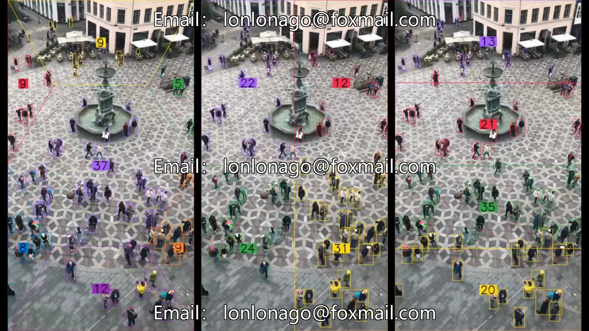

# Based on the YOLO-based object detection dataset, a system for counting people within a region

## Body

Based on the YOLO-based object detection dataset, a system for counting people within a region
Contains a large amount of pedestrian detection annotation data, suitable for research and development of crowd counting algorithms.
The dataset includes urban squares, streets and other scenes, with clear and accurate annotations.
Applicable for pedestrian detection, crowd counting and other related research and applications.
Virtual materials, once sold, are non-refundable.
Interested friends, click "I want".

## Images

## Payment

Here is a pay link on Stripe ( https://buy.stripe.com/3cs8yP7sY87d0vu9AB ). Please contact me lonlonago@foxmail.com after funding $89, and I will send you a complete data files , thank you!

